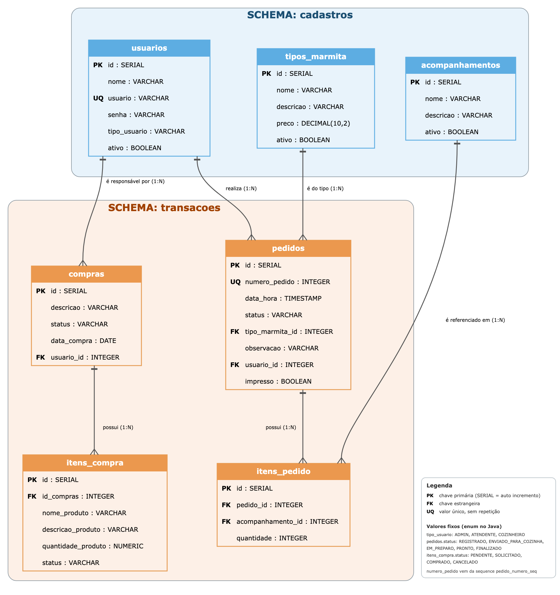

# Sistema GranMestre Restaurante — Backend

API REST do sistema de gestão de um restaurante de marmitas: cadastros, registro de pedidos no balcão, impressão do pedido na cozinha, controle das compras do dia e um dashboard com a visão do dia.

Projeto da Unipar (Laboratório de Software). Este repositório contém **só o backend**. O front-end (React) é feito por outro integrante da equipe.

## O que o sistema faz

| Módulo | Para que serve |
|---|---|
| Login e permissões | O usuário entra com login e senha e recebe um token. Cada perfil (ADMIN, ATENDENTE, COZINHEIRO) acessa só o que lhe cabe. |
| Cadastros | Usuários, tipos de marmita e acompanhamentos, com ativar e desativar. |
| Pedidos | O atendente registra o pedido (marmita, acompanhamentos, observação). O sistema gera o número automaticamente. |
| Impressão | Ao enviar o pedido para a cozinha, o cupom é impresso. Dá para reimprimir. |
| Compras do dia | O cozinheiro monta a lista de compras e marca cada item como solicitado, comprado ou cancelado. |
| Dashboard | Resumo do dia: pedidos pendentes e concluídos, marmitas vendidas e situação das compras. |

## Tecnologias

- Java 17
- Spring Boot 4.1.1 (Web MVC, Data JPA, Security com JWT)
- PostgreSQL 18
- Maven (wrapper incluso)

## Pré-requisitos

- JDK 17 ou superior
- PostgreSQL instalado e rodando (porta 5432)

Não precisa instalar o Maven, o projeto traz o `mvnw`.

## Como rodar

### 1. Criar o banco

O Hibernate **não cria as tabelas** (`ddl-auto=none`). Elas vêm dos scripts da pasta `database/`:

```bash
createdb -U postgres restaurante
psql -U postgres -d restaurante -f database/schema.sql
psql -U postgres -d restaurante -f database/dados-iniciais.sql
```

- `schema.sql` cria os schemas, tabelas, chaves e restrições. Serve só para banco **vazio**.
- `dados-iniciais.sql` cria o primeiro usuário, um ADMIN (veja "Primeiro acesso"). Sem ele, ninguém consegue cadastrar usuários.

### 2. Configurar a conexão

As senhas **não ficam** no `application.properties`, que vai para o GitHub. Crie um arquivo local, que o git ignora:

```bash
cp application-local.example.properties application-local.properties
```

Abra o `application-local.properties` e preencha a senha do seu PostgreSQL:

```properties
spring.datasource.username=postgres
spring.datasource.password=SUA_SENHA_DO_POSTGRES
```

O arquivo precisa ficar na **pasta raiz do projeto**, ao lado do `pom.xml`. Se o banco tiver outro nome ou porta, defina também `spring.datasource.url` (padrão: `jdbc:postgresql://localhost:5432/restaurante`).

Em vez do arquivo, dá para usar variáveis de ambiente: `DB_URL`, `DB_USER`, `DB_PASSWORD` e `JWT_SECRET`.

### 3. Subir a aplicação

```bash
sh ./mvnw spring-boot:run        # macOS e Linux
mvnw.cmd spring-boot:run         # Windows
```

Se preferir, rode `RestauranteApplication` pelo IntelliJ. A API sobe em `http://localhost:8080`.

### 4. Primeiro acesso

O script de dados iniciais cria:

| usuário | senha | perfil |
|---|---|---|
| `admin` | `admin123` | ADMIN |

> **Atenção:** `admin123` é só para desenvolvimento. Troque antes de qualquer uso real: faça login como `admin` e chame `PUT /usuarios/{id}` com uma senha nova.

```bash
# 1) login: devolve o token
curl -X POST http://localhost:8080/login \
  -H "Content-Type: application/json" \
  -d '{"usuario":"admin","senha":"admin123"}'

# 2) use o token nas demais chamadas
curl http://localhost:8080/usuarios \
  -H "Authorization: Bearer COLE_O_TOKEN_AQUI"
```

## Configuração

Os padrões ficam em `src/main/resources/application.properties`. O que é secreto fica em `application-local.properties`.

| Propriedade | Para que serve |
|---|---|
| `spring.datasource.*` | Conexão com o PostgreSQL. Os valores reais ficam em `application-local.properties` (não versionado) ou nas variáveis `DB_URL`, `DB_USER` e `DB_PASSWORD`. |
| `jwt.secret` | Segredo que assina os tokens. O valor do `application.properties` é público e serve só para desenvolvimento. Em produção, defina `JWT_SECRET` (mínimo 32 caracteres). |
| `jwt.expiration-minutes` | Validade do token. Padrão: 480 (8 horas). |
| `impressora.modo` | `simulada` (padrão) ou `rede`. Veja "Impressão". |
| `spring.web.error.*` | As respostas de erro não mostram o stack trace, só a mensagem. |

## Perfis e permissões

O perfil vem dentro do token. Rota fora desta lista fica bloqueada.

| Recurso | ADMIN | ATENDENTE | COZINHEIRO |
|---|:---:|:---:|:---:|
| `/login` | público | público | público |
| `/usuarios` (tudo) | sim | não | não |
| Consultar tipos de marmita e acompanhamentos | sim | sim | não |
| Criar, editar, ativar/desativar e apagar tipos de marmita e acompanhamentos | sim | não | não |
| Consultar pedidos | sim | sim | sim |
| Registrar pedido e reimprimir | sim | sim | não |
| Mudar o **status** do pedido | sim | sim | sim |
| Apagar pedido | sim | não | não |
| Acesso direto a `/itens-pedido` (criar, editar e apagar) | sim | não | não |
| Compras e itens de compra (tudo) | sim | não | sim |
| `GET /dashboard/resumo-pedidos` | sim | sim | sim |
| `GET /dashboard/resumo-compras` | sim | não | sim |

O COZINHEIRO nunca altera itens, acompanhamentos ou valores de um pedido, só o status.

## Endpoints

Todos, exceto `POST /login`, exigem `Authorization: Bearer <token>`.

### Login

- `POST /login` com `{"usuario": "...", "senha": "..."}` devolve `nome`, `usuario`, `tipo_usuario` e `token`.

### Cadastros

Os três módulos têm o mesmo formato:

- `GET /{módulo}`, `GET /{módulo}/{id}`
- `POST /{módulo}`, `PUT /{módulo}/{id}`, `DELETE /{módulo}/{id}`
- `PATCH /{módulo}/{id}/ativo` com `{"ativo": false}`

Onde `{módulo}` é `usuarios`, `tipos-marmita` ou `acompanhamentos`.

Para a tela de pedidos, só os ativos: `GET /tipos-marmita/ativos` e `GET /acompanhamentos/ativos`.

Ao cadastrar, **sempre envie `"ativo": true`**. Se for omitido, o item é criado inativo.

**Proteção do ADMIN:** o sistema nunca fica sem um ADMIN ativo. Um ADMIN não consegue desativar, apagar nem rebaixar a própria conta (editar o próprio nome e senha é permitido), e ninguém consegue tirar o último ADMIN ativo.

### Pedidos

- `POST /pedidos`: registra o pedido e seus itens de uma vez.
  ```json
  { "tipoMarmitaId": 1, "observacao": "sem cebola",
    "itens": [ { "acompanhamentoId": 3, "quantidade": 2 } ] }
  ```
  O servidor preenche número, data e hora, status `REGISTRADO` e o atendente (vem do token).
- `GET /pedidos` e `GET /pedidos?status=REGISTRADO`
- `GET /pedidos/{id}`
- `PUT /pedidos/{id}/status` com `{"status": "EM_PREPARO"}`
- `POST /pedidos/{id}/reimprimir`
- `DELETE /pedidos/{id}`

Os itens do pedido são criados junto com ele em `POST /pedidos`. O acesso direto a `/itens-pedido` é só do ADMIN e valida pedido, acompanhamento e quantidade.

Status do pedido, em ordem: `REGISTRADO` → `ENVIADO_PARA_COZINHA` → `EM_PREPARO` → `PRONTO` → `FINALIZADO`.

### Compras

- `POST /compras`: cria a lista do dia. A data é a de hoje e o responsável vem do token.
- `POST /itens-compra`: adiciona um produto à lista.
  ```json
  { "compra": { "id": 1 }, "nome_produto": "Arroz",
    "descricao_produto": "Pacote 5kg", "quantidade_produto": 10 }
  ```
- `GET /itens-compra/hoje` e `GET /itens-compra/hoje?status=PENDENTE`
- `GET /itens-compra?data=2026-10-07&status=COMPRADO`
- `PUT /itens-compra/{id}/status` com `{"status": "SOLICITADO"}`
- Demais: `GET`, `PUT` e `DELETE` em `/itens-compra/{id}`, e `/compras/{id}`.

Status do item: `PENDENTE`, `SOLICITADO`, `COMPRADO` e `CANCELADO`.

### Dashboard

- `GET /dashboard/resumo-pedidos`: total do dia, marmitas vendidas, pendentes, concluídos, contagem por status e por tipo de marmita.
- `GET /dashboard/resumo-compras`: totais, contagem por status, itens pendentes e itens comprados.

Os dois aceitam `?data=AAAA-MM-DD`. Sem o parâmetro, usam hoje.

### Códigos de erro

| Código | Quando |
|---|---|
| 400 | Dado inválido ou campo obrigatório ausente, ou valor fora da lista (por exemplo, status inexistente). A resposta traz `message` com os valores aceitos. |
| 401 | Sem token, token inválido, ou login errado. |
| 403 | Perfil sem permissão, ou usuário inativo no login. |
| 404 | Registro não encontrado. |
| 409 | Login já em uso, exclusão de algo que já está em uso (desative em vez de excluir), ou tentativa de o ADMIN desativar, apagar ou rebaixar a própria conta, ou de deixar o sistema sem ADMIN ativo. |
| 503 | Falha na impressão. |

## Impressão do pedido na cozinha

O cupom é impresso quando o status vira `ENVIADO_PARA_COZINHA`:

- Se a impressão **falhar**, a API responde 503 com uma mensagem, o status **não muda** e o pedido continua salvo.
- Repetir o envio **não** imprime de novo.
- `POST /pedidos/{id}/reimprimir` imprime outra vez, com o aviso `*** REIMPRESSAO ***`.

Dois modos, escolhidos em `impressora.modo`:

| Modo | O que faz |
|---|---|
| `simulada` (padrão) | Grava os cupons em `impressoes/cupons-simulados.txt`. Não precisa de impressora. |
| `rede` | Envia comandos ESC/POS por TCP (porta 9100) a uma impressora térmica de cupom, como Elgin ou Bematech. Exige `impressora.host`. |

Para testar o cenário de falha sem impressora, use `impressora.simulada.falhar=true`.

> O modo `rede` **ainda não foi testado com impressora física**. Foi validado só contra um servidor TCP que imita a impressora. O modelo e a forma de conexão da impressora do restaurante ainda precisam ser definidos pelo PO.

## Banco de dados



- Schema `cadastros`: `usuarios`, `tipos_marmita`, `acompanhamentos`.
- Schema `transacoes`: `pedidos`, `itens_pedido`, `compras`, `itens_compra`.
- O número do pedido vem da sequence `transacoes.pedido_numero_seq`.
- `usuarios.usuario` e `pedidos.numero_pedido` são únicos.

O arquivo `database/diagrama-der.svg` é a versão editável do diagrama.

**Mudou o banco?** Atualize o `database/schema.sql` junto, senão quem criar o banco do zero ficará com a estrutura antiga.

## Estrutura do projeto

```
src/main/java/org/example/restaurante/
├── controller/   recebe as requisições HTTP
├── service/      regras de negócio
├── repository/   acesso ao banco (Spring Data JPA)
├── model/        entidades e enums
├── dto/          objetos de entrada e saída da API
├── config/       segurança (JWT) e CORS
└── impressao/    impressora e montagem do cupom
database/         schema.sql, dados-iniciais.sql e diagrama do banco
```

## Testes

```bash
sh ./mvnw test
```

Existe um teste que verifica se a aplicação sobe e conecta ao banco, então o PostgreSQL precisa estar rodando. Os demais fluxos foram testados chamando a API.

## Problemas comuns

| Sintoma | Causa provável |
|---|---|
| A aplicação não sobe e reclama de conexão ou de senha | PostgreSQL parado, ou falta o `application-local.properties` na pasta raiz com a senha correta (o padrão do `application.properties` é só um marcador). |
| `relation "..." does not exist` | O banco foi criado sem rodar o `database/schema.sql`. |
| `permission denied: ./mvnw` | Use `sh ./mvnw ...` ou `chmod +x mvnw`. |
| Login retorna 401 com a senha certa | O usuário foi cadastrado fora da API, com senha em texto puro. O login só aceita senha em BCrypt. |
| Todas as rotas retornam 401 | Falta o cabeçalho `Authorization: Bearer <token>`, ou o token expirou. Faça login de novo. |
| Itens ou tipos cadastrados não aparecem na lista de ativos | O cadastro foi feito sem `"ativo": true`. |
| `Defina impressora.host quando impressora.modo=rede` | No modo `rede`, falta preencher `impressora.host`. |

## Pendências conhecidas

- Definir com o PO a impressora real (modelo, conexão e erros a detectar) e testar com ela.
- Validar com o PO as definições do Dashboard (o que é pedido pendente e concluído).
- Trocar a senha do ADMIN inicial e definir `JWT_SECRET` antes de qualquer uso real.
- Não versionar o `application-local.properties`. O `.gitignore` já o ignora.
- Um token continua válido até expirar, mesmo que o usuário seja desativado depois.
